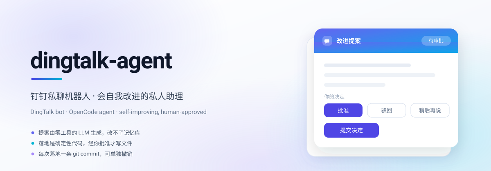
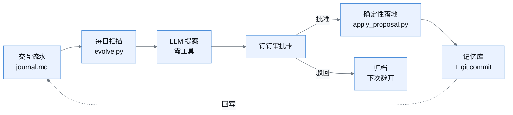
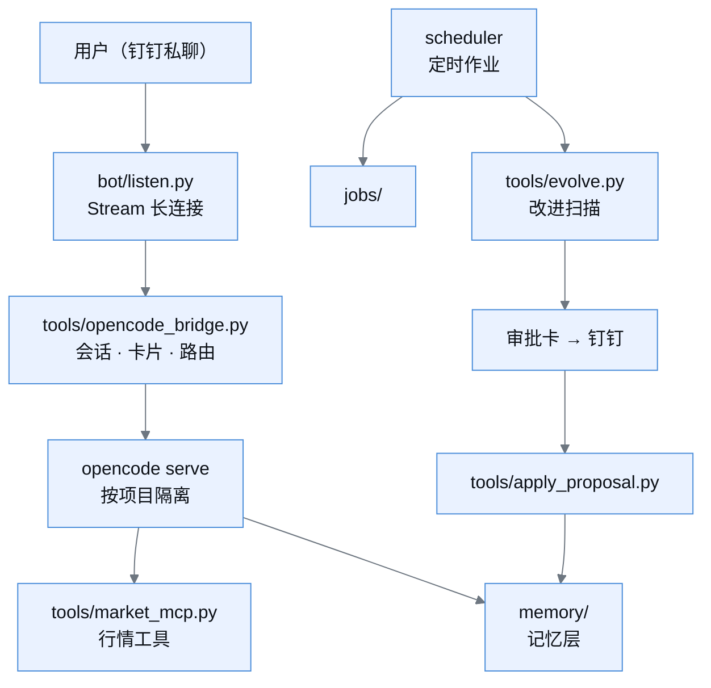

<p align="center">
  
</p>

<p align="center">
  <b>钉钉私聊机器人 · 会自我改进的私人助理</b><br>
  <sub>DingTalk bot · OpenCode agent · self-improving, human-approved</sub>
</p>

<p align="center">
  
  
  
  
  
</p>

<p align="center">
  <a href="#能力">能力</a> ·
  <a href="#自我改进闭环">自我改进闭环</a> ·
  <a href="#快速开始">快速开始</a> ·
  <a href="#架构">架构</a> ·
  <a href="#定时作业">定时作业</a> ·
  <a href="#文档">文档</a>
</p>

<br>

> [!NOTE]
> 这是一个**自用项目**：跑在个人 Windows 机器上，通过钉钉 Stream 长连接与用户私聊。
> 仓库里的 `jobs/` 是我自己的定时报告作业，与机器人本体解耦，可以整目录替换。

## 能力

- 💬 **钉钉私聊机器人** — Stream 长连接接入，卡片 v2 支持 Markdown、表单、图片推送
- 🧠 **OpenCode Agent 驱动** — 复用本机 `opencode serve`，按项目隔离会话、工具与上下文
- 🃏 **全卡片交互** — 问答、重试、停止、审批全部走卡片回调，不做轮询
- 📈 **行情 MCP 工具集** — `quote` / `overseas` / `wave` / `tech` / `news` 五类工具，附指标图与证据背书
- ⏰ **内置调度器** — 四个定时作业，带补跑窗口，支持手动触发
- 🧬 **记忆层** — append-only、三级信任分级、写入闸门、有界上限
- 🔁 **自我改进闭环** — 每日扫描产出提案，**经钉钉审批后才落地**
- 🔍 **全链路可审计** — 每次落地一条独立 git commit，可单独 revert

## 自我改进闭环

这是本项目区别于普通「套壳聊天机器人」的部分：它会从自己的对话里学到东西，
然后**改自己的记忆**——但改之前必须过你这一关。



三条硬约束：

| 约束 | 实现 |
|---|---|
| **评估器住在循环改不到的地方** | 提案者直连 LLM，**没有任何工具**，物理上改不了记忆库 |
| **提案权 ≠ 变更权** | 提案落 `memory/proposals/`，你点「批准」才写文件 |
| **落地是确定性代码** | `apply_proposal.py` 只做白名单校验 + 追加 + git commit，不经 LLM |

配套护栏：每 scope 记忆条数上限、pinned 条目不可被自动取代、
同一句用户原话不重复入库、每次落地记录验收快照。细节见
[docs/self-improvement.md](docs/self-improvement.md)。

## 快速开始

前置条件：Python 3.10+、一个钉钉机器人（`APP_KEY` / `APP_SECRET`）、
本机已运行 `opencode serve`。

```bash
# 1) 配置
cp .env.example .env    # 填 APP_KEY / APP_SECRET / 模型 key

# 2) 起机器人（长连接，Stream 模式）
python bot/listen.py

# 3) 起调度器（定时作业）
python -m scheduler serve
```

机器人起来后，直接在钉钉私聊里发消息即可。重启用：

```bash
python tools/bot_restart.py "重启原因"   # 会话不丢，带状态提示
```

<details>
<summary>环境变量</summary>

| 变量 | 用途 |
|---|---|
| `APP_KEY` / `APP_SECRET` | 钉钉机器人凭据 |
| `EVOLVE_LLM_BASE_URL` / `EVOLVE_LLM_MODEL` | 改进扫描用的模型通道（与主模型解耦） |
| `EVOLVE_LLM_FALLBACK_MODEL` | 主模型失败时自动降级 |
| `LLM_API_KEY` / `LLM_MODEL_ID` / `LLM_BASE_URL` | Agent 主模型通道 |

`.env` **不入 git**。所有密钥只从环境变量读。

</details>

## 架构



<details>
<summary>目录结构</summary>

```
bot/         钉钉 Stream 接入、卡片 v1/v2、推送、在线状态
tools/       Agent 桥接、行情 MCP、记忆层、自我改进、评估器
datalayer/   行情数据源封装（baostock / akshare / 东财 / 同花顺）
jobs/        定时业务作业（盘前早报 / IC 信号 / IC 周报）
scheduler/   调度器守护进程 + 作业注册表
memory/      记忆层：global / project / journal / proposals
var/         运行期产物（IC 信号、状态图、PNG），已 gitignore
.opencode-bot/ 机器人专用 Agent 配置（AGENTS.md + opencode.json）
docs/        架构、调度、自我改进的设计文档
```

</details>

## 定时作业

| 作业 | 触发 | 说明 |
|---|---|---|
| `evolve` | 每天 03:00 | 知识与行为改进扫描，产出提案推审批卡 |
| `premarket` | 每天 08:00 | 盘前早报 |
| `ic_monitor` | 周一~周五 08:50 | IC 信号监控 |
| `ic_weekly` | 周一 09:05 | IC 周报 |

```bash
python -m scheduler list          # 作业清单与下次触发时间
python -m scheduler run evolve    # 手动补跑一次
```

作业定义在 `scheduler/registry.py`，所有作业都带**补跑窗口**（错过触发时间仍会在
窗口内执行），支持手动 `/run <作业>`。

## 文档

| 文档 | 内容 |
|---|---|
| [docs/bot-architecture.md](docs/bot-architecture.md) | 机器人整体架构与会话生命周期 |
| [docs/scheduler.md](docs/scheduler.md) | 调度语义、作业注册、补跑策略 |
| [docs/self-improvement.md](docs/self-improvement.md) | 自我改进闭环的设计、护栏与已知限制 |
| [memory/README.md](memory/README.md) | 记忆层速查（信任分级、闸门、有界规则） |

## 路线图

- [x] 钉钉私聊 + 卡片 v2 全交互
- [x] OpenCode Agent 接入与项目隔离
- [x] 定时作业与补跑窗口
- [x] 记忆层：append-only + 信任分级 + 写入闸门
- [x] 自我改进闭环：每日扫描 → 钉钉审批 → 确定性落地
- [x] 变更验收：held-out 判例上的 A/B 对照
- [ ] 记忆库语义检索（等分层治理跑顺）
- [ ] 跨会话去重（当前靠证据逐字比对 + 人工确认）
- [ ] 更多行情数据源

---

<sub>个人项目，仅供学习参考。仓库不含任何密钥，`.env` 已在 <code>.gitignore</code> 中。</sub>
